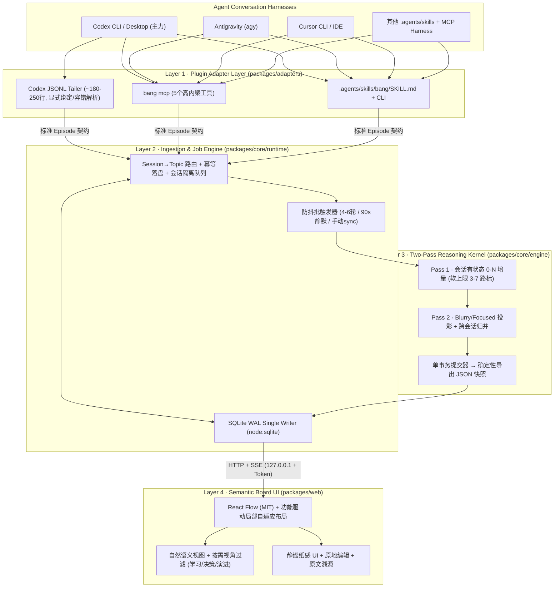
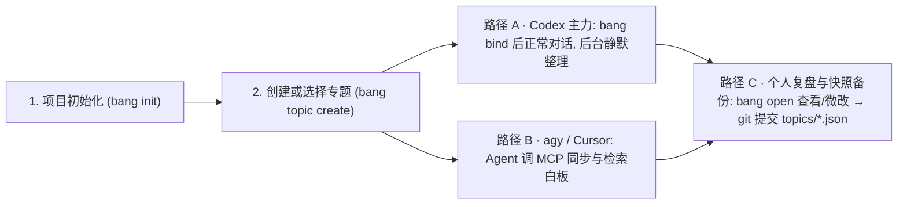

# Bang v2 系统需求与重构架构设计文档

**文档定位**：面向 Bang 项目全面重构的系统级需求规格、使用流程与技术架构设计（覆盖插件化接入、三平面认知 IR、两层逻辑整理引擎、终端使用流程与进程生命周期、React Flow 静谧纸感前端与功能驱动布局体系，以及现有仓库冗余代码的清理迁移方案）。

**适用范围**：Bang v2 供单人使用，多人协作不在本版范围内。同一用户可以在多个会话、工具和设备间延续专题。以 **Codex** 为一等公民，原生支持 **Antigravity (`agy`)**、**Cursor CLI**、OpenCode 等遵循 `.agents/skills/` 与 MCP 规范的 Agent Harness（**不包含 Claude / Claude Code 生态**）。

---

## 1. 回到本质：重新审视 Bang 的产品定位与设计原则

### 1.1 为什么现有版本与“完备知识图谱”都会走向失焦

回顾当前 `kongxiangcong/bang` 仓库（255 个有效源码文件、18,185 行代码），系统先后落入了两个陷阱的边缘：

1. **V1 的现实陷阱——过度防御式治理与手工画板化**：6 套历史运行时并存（`canvas` / `codex` / `native` / `bundle` / `dsh` / `companion`），依赖预编译 C 锁进程、Ed25519 批次验签、`CODEX_VERSION` 硬编码与 18 个手工维护面板，却把核心语义整理压缩成了一句 120 词的 Prompt 与无类型矩形方块。
2. **V2 的潜在陷阱——过度本体化带来的认知过载**：如果后台把 40 轮对话无损抽成一张 60 个节点、100 条边的“完备百科知识图谱”，因为用户没有亲手从零搭建过这张图，两周后再次打开只会觉得像在读陌生人的教材——**图越全、节点越密，回忆门槛越高**。

### 1.2 重新定义 Bang：认知路标图（Cognitive Landmark / Recall Map）

Bang 的本质不是“替你画一张百科全书”，也不是“手工绘图工具”，而是**附着在原生对话工具旁边的个人认知路标系统**：

> **Plane 0（本地原始对话记录）才是无损真相源；白板只需要充当稀疏的“认知路标索引”，供用户查看当前结论、成立条件与未决问题，并在需要时沿路标回看关键转折和对应原文。**

### 1.3 五条不可妥协的架构铁律

| 原则 | 具体约束 | 直接解决的痛点 |
| :--- | :--- | :--- |
| **1. 强制稀疏与按需增减（Landmark-first）** | 单次会话的**软预算为 3–7 个认知路标**；**单次增量允许输出 0–N 个变动**（无新认知理解时仅保存原文、不强行改图），绝不为每轮对话建方块；推导细节与原文折叠在抽屉里按需展开。 | 避免自动生成的全量图谱或机械增量导致节点膨胀，保持“一眼看懂”的复盘效率。 |
| **2. 客观知识与个人认知解耦** | 领域知识（概念、命题、条件、依据）与个人状态（掌握度、立场、曾经的误解与纠偏史）分平面存储。 | 知识本身没变时，学习进度和认知纠偏仍可独立演化；原生统一学习、实验与设计讨论。 |
| **3. 单一写入权威（Single Writer）** | 固定使用 **Node >= 22.13 原生 `node:sqlite`**（SQLite WAL 模式，**零第三方原生 C/C++ `node-gyp` 绑定依赖**）作为唯一运行时写入权威；`knowledge.json` / `epistemic.json` / `layout.json` 为提交后确定性刷出的只读快照；`.bang/config.json` 仅存非敏感项目默认配置，绝不存放 API Key 或专题状态列表。 | 彻底消灭数据库与 JSON 文件双写脑裂、并发锁死、原生模块编译失败与敏感凭据误提交风险。 |
| **4. 渐进参与与非侵入** | 默认**零预设区域、零大段引导词**，白板只表达真实产生的内容结构；AI 负责结构化整理，人类复盘时只需极轻操作（Pin / Verify-Shaky / Fold）或按需原地微调正文与连线，所有人工修改零丢失、绝不阻塞后台管线。 | 让白板打开即安静可用，既无需手动画框、不被教学噪音打扰，又能快速长成“用户自己认得的样子”。 |
| **5. 最小必要防护、零版本硬编码** | 彻底废除 C 原生锁、Ed25519 内部签验与 `CODEX_VERSION` 字符串锁；仅保留必要的本地服务 Token/Origin 校验与 Codex CLI 只读沙箱隔离；所有失败按会话隔离并可显式重试。 | 根治“后台无反应”与“工具升级即静默失灵”，同时防止本地对话原文被任意网页跨站读取。 |

---

## 2. 总体架构：面向任意 Agent Harness 的插件化四层架构

Bang v2 收敛为一个轻量化 TypeScript Monorepo（目标有效代码量控制在 **5,000–7,000 行**，相比 V1 的 18,185 行精简约 65%–70%，**零原生 C/C++ 编译依赖**，运行前置仅为 **Node >= 22.13**），自顶向下分为四个完全解耦的层次：



### 2.1 目标 Monorepo 目录结构

```text
bang/
├── package.json                  # pnpm workspace 根配置 (engines: node >= 22.13)
├── packages/
│   ├── core/                     # 核心引擎（无 UI、无特定 Harness 依赖）
│   │   ├── src/
│   │   │   ├── ir/               # 三平面 TypeScript Schema 与校验器
│   │   │   ├── db/               # node:sqlite WAL 单写层、7表迁移、乐观锁与快照导出器
│   │   │   ├── queue/            # 幂等采集、防抖触发、会话级作业状态机
│   │   │   ├── engine/           # Pass 1 / Pass 2 提示词、双精度投影、归并算子
│   │   │   ├── llm/              # 可插拔 LLMProvider（OpenAI 兼容 / Codex CLI / 本地模型）
│   │   │   └── server/           # 本地轻量 HTTP + SSE API（Token/Origin 安全校验）
│   ├── adapters/                 # Harness 插件适配层
│   │   ├── src/
│   │   │   ├── cli.ts            # `bang init / topic / bind / unbind / serve / stop / status / open / ingest / sync / retry / inspect / import / export / mcp`
│   │   │   ├── mcp.ts            # `bang mcp`（5 个标准 MCP 工具）
│   │   │   ├── codex-watcher.ts  # Codex 本地 JSONL 只读尾随器（显式绑定 + 容错解析）
│   │   │   └── templates/        # `.agents/skills/bang/SKILL.md` 与 `AGENTS.md` 片段
│   └── web/                      # React Flow 静谧纸感语义白板前端
│       ├── src/
│       │   ├── nodes/            # 4 类去表单标签语义卡片 + 悬停微操作
│       │   ├── edges/            # 9 类骨架边 + 自然语言谓词胶囊 + 端点重连
│       │   ├── layout/           # 功能驱动的局部簇自适应布局（层级/流程/对比/发散）+ Pin/手拖防碰撞保护
│       │   ├── lenses/           # 自然自适应视图 + 按需视角过滤（学习 / 决策 / 演进）
│       │   ├── panels/           # 按需滑出抽屉（详情与 KaTeX / 原文溯源 / 纠偏时间线 / Proposal）
│       │   └── motion/           # 局部增量入场与状态演化动效（支持 prefers-reduced-motion）
└── baselines/
    └── eval-cases/               # 保留并扩展自旧版 quality-cases.json（兼容 Q01–Q20 + 新增 GDN 学习案例）
```

### 2.2 项目本地数据目录（`.bang/`）

每个接入 Bang 的项目根目录维护极简的 `.bang/` 结构，严格隔离“运行时私有数据 / 进程发现凭证”与“可进 Git 的可读快照”：

```text
<project-root>/
├── .agents/skills/bang/SKILL.md  # 自动安装的跨 Harness 技能说明
└── .bang/
    ├── bang.db                   # node:sqlite WAL 唯一写入权威（默认 .gitignore，含 7 张核心表）
    ├── server.json               # 当前守护进程发现文件 {pid, port, token, started_at, project_root}（.gitignore，0600 权限）
    ├── config.json               # 可进 Git 的非敏感项目默认配置（Provider 类型/模型名、防抖阈值、auto_watch_project 默认 false）
    └── topics/
        └── <topic-slug>/
            ├── knowledge.json    # 自动导出的客观知识图谱（只读快照，Git 友好）
            ├── epistemic.json    # 自动导出的个人认知状态与误解纠偏史（只读快照）
            └── layout.json       # 坐标、折叠态与用户 Pin 锚点（与语义版本物理分离）
```

> **凭据隔离约束**：`.bang/config.json` **严禁保存 API Key** 或专题运行态列表。LLM 鉴权密钥统一通过环境变量（`BANG_API_KEY` / `OPENAI_API_KEY`）或用户主目录下的 `~/.bang/credentials.json`（`0600` 权限）读取。

---

## 3. 三平面认知 IR 与数据存储设计

参考 [Graphiti](https://github.com/getzep/graphiti) 的不可变 Episode 与时间模型、[Graphify](https://github.com/Graphify-Labs/graphify) 的边置信度标注，以及 [Kanvas](https://github.com/XMihura/Kanvas) 的字段级人机权限隔离，底层 IR 严格划分为三个正交平面。

### 3.1 Plane 0 与运行时存储（`node:sqlite` WAL，7 张核心轻量表）

固定使用 Node >= 22.13 原生内置模块 `node:sqlite`，连接初始化开启 `PRAGMA journal_mode = WAL; PRAGMA busy_timeout = 5000;`。全部运行时状态由以下 **7 张表**统一管理：

```sql
-- 1. 专题元数据（取代旧版/草稿中 config.json 存专题列表的双写隐患）
CREATE TABLE topics (
  id          TEXT PRIMARY KEY,
  slug        TEXT UNIQUE NOT NULL,
  title       TEXT NOT NULL,
  description TEXT NOT NULL DEFAULT '',
  status      TEXT NOT NULL DEFAULT 'active',  -- 'active' | 'archived'
  created_at  TEXT NOT NULL,
  updated_at  TEXT NOT NULL
);

-- 2. 原始轮次的不可变版本；不同轮次可以有完全相同的问答
CREATE TABLE episodes (
  id                  TEXT PRIMARY KEY,        -- uuid
  topic_id            TEXT NOT NULL,
  harness             TEXT NOT NULL,           -- 'codex' | 'agy' | 'cursor' | 'cli'
  session_id          TEXT NOT NULL,
  source_turn_id      TEXT NOT NULL,           -- 来源会话内稳定的轮次标识；重投、修订沿用
  turn_index          INTEGER NOT NULL,
  user_text           TEXT NOT NULL,
  assistant_text      TEXT NOT NULL,
  content_hash        TEXT NOT NULL,           -- sha256(user_text + '\n' + assistant_text)
  replaces_episode_id TEXT,                    -- 指向被修订的旧来源轮次，支持版本追溯 (Q20)
  occurred_at         TEXT NOT NULL,           -- 对话发生时间 (ISO-8601)
  recorded_at         TEXT NOT NULL,           -- Bang 采集入库时间 (ISO-8601)
  FOREIGN KEY(replaces_episode_id) REFERENCES episodes(id)
);
-- 每轮一份初版，每个旧版最多接一份直接修订
CREATE UNIQUE INDEX episode_original ON episodes(topic_id, harness, session_id, source_turn_id)
  WHERE replaces_episode_id IS NULL;
CREATE UNIQUE INDEX episode_successor ON episodes(replaces_episode_id)
  WHERE replaces_episode_id IS NOT NULL;

-- 3. 轻量采集水位与显式绑定关系（跨平台签名，不依赖脆弱的 POSIX inode）
CREATE TABLE adapter_cursors (
  adapter_key    TEXT PRIMARY KEY,             -- e.g. 'codex:/path/to/session.jsonl'
  harness        TEXT NOT NULL,
  session_id     TEXT NOT NULL,
  topic_id       TEXT NOT NULL,
  enabled        INTEGER NOT NULL DEFAULT 1,   -- 1=已显式绑定采集, 0=显式解绑；停机保持绑定状态
  file_signature TEXT,                         -- 首行 session_meta 哈希，替代 Windows 不可靠的 inode
  capture_from_offset INTEGER NOT NULL,        -- 本次绑定的采集起点，重启或重新定位文件时仍须遵守
  byte_offset    INTEGER NOT NULL,             -- 已读取位置，首次绑定时从采集起点初始化
  line_buffer    TEXT NOT NULL DEFAULT '',     -- 防止半行 JSON 写入截断
  last_turn_id   TEXT,
  updated_at     TEXT NOT NULL
);

-- 4. Pass 1 会话级中间路标缓存（支撑有状态增量重组与 Pass 2 独立重试）
CREATE TABLE session_subgraphs (
  topic_id        TEXT NOT NULL,
  session_id      TEXT NOT NULL,
  subgraph_json   TEXT NOT NULL,               -- 本会话沉淀的候选路标与局部 epistemic_hint
  last_episode_id TEXT,
  updated_at      TEXT NOT NULL,
  PRIMARY KEY(topic_id, session_id)
);

-- 5. 会话级隔离作业队列（单会话失败绝不阻塞同专题其他会话）
CREATE TABLE jobs (
  id            TEXT PRIMARY KEY,
  topic_id      TEXT NOT NULL,
  session_id    TEXT NOT NULL,
  stage         TEXT NOT NULL,                 -- 'pass1_session' | 'pass2_merge'
  episode_ids   TEXT NOT NULL,                 -- JSON string[]
  payload_json  TEXT,                          -- 可选中间上下文载荷
  status        TEXT NOT NULL,                 -- 'pending' | 'running' | 'done' | 'failed'
  attempts      INTEGER NOT NULL DEFAULT 0,
  next_retry_at TEXT,
  error_code    TEXT,
  error_detail  TEXT,
  created_at    TEXT NOT NULL,
  updated_at    TEXT NOT NULL
);

-- 6. 专题语义版本快照（仅记录 Plane 1 与 Plane 2，不受拖拽坐标污染）
CREATE TABLE topic_revisions (
  topic_id       TEXT NOT NULL,
  revision       INTEGER NOT NULL,
  trigger_job_id TEXT,
  author         TEXT NOT NULL,                -- 'engine' | 'human' | 'import'
  summary        TEXT NOT NULL,                -- 人类可读变更摘要
  knowledge_json TEXT NOT NULL,                -- Plane 1 完整状态
  epistemic_json TEXT NOT NULL,                -- Plane 2 完整状态
  created_at     TEXT NOT NULL,
  PRIMARY KEY(topic_id, revision)
);

-- 7. 专题画布布局状态（独立于语义版本，拖拽/折叠原地更新，不递增 revision）
CREATE TABLE topic_layouts (
  topic_id    TEXT PRIMARY KEY,
  layout_json TEXT NOT NULL,
  updated_at  TEXT NOT NULL
);
```

**写入权威、乐观锁与人机并发规则**：
1. **语义 vs 布局分离写入**：任何语义/认知修改（后台 Pass 2 归并、MCP 状态更新、前端人工编辑节点/边/微操作）必须在单个 SQLite 事务中写入 `topic_revisions`（递增 `revision`）并原子覆写对应 `.bang/topics/<slug>/knowledge.json` 与 `epistemic.json`。前端拖拽节点坐标或保存视口折叠状态仅更新 `topic_layouts` 并原子刷新 `layout.json`，**不递增语义 `revision`**，保证历史版本回放只反映思考演化而非鼠标拖动轨迹。
2. **乐观锁与无冲突合并**：前端人工编辑提交必须携带 `base_revision`。若期间后台 Pass 2 恰好推进了 `revision`，事务内按节点/字段粒度校验：修改互不相交则自动合并递进；若后台恰好修改了同一节点的人工锁定字段或同一条被锁定的边，事务**保留人类写入**并将后台提案转为非阻塞 `PendingProposal`（反之亦然，Pass 2 提交前亦执行同款校验，绝不丢失人工编辑，也不卡死队列）。
3. 外部直接手动修改硬盘上的导出 JSON 不直接视为运行时输入，如需从 Git 拉取或外部编辑恢复，须显式执行 `bang import`。以语义、认知和布局三份快照作为一个整体，按以下顺序判断。

   | 本机与待导入快照的关系 | 导入行为 |
   | --- | --- |
   | 本机尚无该专题 | 从快照建立基线 |
   | 三份内容一致 | 跳过，不新增版本 |
   | 可确认本机状态是待导入状态的祖先 | 采用待导入快照；仅布局变化时只更新布局 |
   | 可确认待导入状态是本机状态的祖先 | 保留本机修改，跳过旧快照，不新增版本 |
   | 内容不同，且双方已分叉或无法确认先后 | 停止导入，保留本机状态和待导入快照供用户选择；后续自动导出也须保护待选快照 |

   自动采用单边修改须有可核对的共同基线和变更来源。例如，能将两端的完整专题状态分别对应到同一条 Git 提交链，且已核对本机数据库和待导入文件均与对应状态相符。文件时间、跨机比较的语义版本号或单个文件的内容不足以证明祖先关系。

### 3.2 Plane 1 · 客观知识与命题层（4 节点 + 9 骨架边 + 开放谓词 + 涌现局部簇）

为了同时解决“模型分类漂移”、GDN 案例中的因果追问，以及通用思维结构（分类、循环流程、多维度权衡、独立子区域局部稳定）的表达需求，采用 **4 类正交核心节点 + 9 类固定结构骨架边 + 开放自然语言谓词 + 按需涌现局部簇**：

```typescript
export type NodeKind = 'concept' | 'claim' | 'question' | 'evidence';

export type NodeTag =
  | 'concept' | 'principle' | 'option' | 'artifact'            // concept 细分视觉标签
  | 'hypothesis' | 'decision' | 'finding'                      // claim 细分视觉标签
  | 'open_question' | 'design_issue'                           // question 细分视觉标签
  | 'derivation' | 'experiment' | 'counterexample' | 'code_ref'; // evidence 细分标签

// 'resolved' 专用于已闭合的 question 节点
export type ValidityStatus =
  | 'active'
  | 'qualified'
  | 'disputed'
  | 'superseded'
  | 'resolved';

export interface KnowledgeNode {
  id: string;                        // 稳定语义 slug，如 "n_delta_rule_sk"
  kind: NodeKind;
  tag?: NodeTag;                     // 可选轻量标签，仅用于视觉分化，不分裂 Schema
  title: string;                     // 简短路标标题（≤ 24 字，画布直接显示）
  detail: string;                    // 完整精炼解释（抽屉展开，含公式/代码摘要）
  conditions: string[];              // 成立前提与边界条件（不可静默丢弃）
  status: ValidityStatus;
  source_episodes: string[];         // Plane 0 episode_id 溯源锚点
  // 三层务实时间语义：区分“领域事件时间”、“讨论提出时间”与“系统入库时间”
  event_time?: string;               // 可选领域事件实际发生时间/区间（如 "周一发布"），防止与发言时间混淆
  asserted_at: string;               // 讨论中首次提出该命题的时间
  superseded_at?: string;            // 讨论中被新证据推翻的时间
  recorded_at: string;               // Bang 首次入库时间
  invalidated_at?: string;           // Bang 确认其失活/被替代的记录时间
}

export type EdgeSkeleton =
  | 'about'        // Claim / Question → Concept（归属主题 / 放射分支）
  | 'answers'      // Claim / Evidence → Question（直接回答 / 解释问题）
  | 'part_of'      // Concept / Claim → Concept（分类、成员归属、子模块包含）
  | 'depends_on'   // A → B（前置知识依赖 / 逻辑前提）
  | 'leads_to'     // A → B（执行步骤 / 因果流转 / 合法循环 / 时间演进）
  | 'supports'     // Evidence / Claim → Claim（推导支持）
  | 'refutes'      // Evidence / Claim → Claim（反例推翻）
  | 'qualifies'    // Evidence / Claim → Claim（收窄 / 限定成立条件）
  | 'supersedes';  // 新 Claim → 旧 Claim（新判断替代旧判断，保留演化链）

export interface KnowledgeEdge {
  id: string;
  from: string;
  to: string;
  skeleton: EdgeSkeleton;            // 固定 9 类骨架，供功能自适应布局、视图过滤与查询使用
  predicate: string;                 // 开放自然语言短谓词，如 "作为 Key 的预测值"
  provenance: 'EXTRACTED' | 'INFERRED'; // 对话明示 vs 模型归纳
  human_locked?: boolean;            // 人工改接端点或编辑谓词后置 true，保护不被 AI 静默改回
  source_episodes: string[];
  asserted_at: string;
  recorded_at: string;
  invalidated_at?: string;           // 边失效时不删除，标记失活以保留历史
}

// 仅当对话自然分化出多个相对独立子主题（如“存储对比”与“网络对比”）时按需涌现；
// 严禁在空白画布或新专题初始化时预创建任何空 Cluster 或模板区域。
export interface KnowledgeCluster {
  id: string;
  title: string;
  node_ids: string[];
  layout_hint?: 'auto' | 'hierarchy' | 'flow' | 'radial' | 'comparison' | 'free';
}

export interface KnowledgeGraph {
  topic_id: string;
  nodes: KnowledgeNode[];
  edges: KnowledgeEdge[];
  clusters?: KnowledgeCluster[];
}
```

### 3.3 Plane 2 · 个人认知状态与人机协同层（`epistemic.json`）

客观知识（Plane 1）描述“原理本身是什么”，个人认知层（Plane 2）独立描述“你现在懂到什么程度、曾经哪里想错了、你手动钉住了什么”。每个专题记录使用者本人的掌握度、立场与纠偏史；在自己的另一台设备导入快照后，这些记录仍属于本人。两者按 `node_id`（以及 Proposal 关联的 `target_id`）关联，互不覆盖：

```typescript
// 严格区分“口头说懂了”与“经推导/实践验证掌握”
export type MasteryLevel =
  | 'unfamiliar'     // 刚接触，未展开
  | 'exploring'      // 正在讨论/学习中
  | 'self_reported'  // 用户自述“理解了”（模型严禁自动标为 verified）
  | 'verified'       // 用户在后续推导/复述/代码中验证过，或手动确认掌握
  | 'shaky';         // 后续暴露反例或自我怀疑，打回待巩固

export type StanceLevel = 'neutral' | 'endorsed' | 'skeptical' | 'rejected';

export interface BeliefShift {
  id: string;
  previous_belief: string;           // 曾经的误解或旧直觉（Misconception）
  correction: string;                // 纠偏后的新理解
  trigger_episode_id: string;        // 击破误解的那一轮对话锚点
  shifted_at: string;                // 发生认知转折的讨论时间
  recorded_at: string;               // 系统记录时间
}

export interface PendingProposal {
  id: string;
  target_kind: 'node' | 'edge';
  target_id: string;
  field: 'title' | 'detail' | 'conditions' | 'endpoint' | 'predicate';
  proposed_value: string | string[] | { from: string; to: string };
  reason: string;
  source_episodes: string[];
  created_at: string;
}

export interface NodeEpistemicState {
  node_id: string;
  mastery?: MasteryLevel;
  stance?: StanceLevel;
  pinned: boolean;                   // 用户“钉为主干”路标
  folded: boolean;                   // 用户“折叠噪音”
  human_locked_fields: ('title' | 'detail' | 'conditions')[]; // 人类手改字段，AI 永不静默覆写
  belief_history: BeliefShift[];     // 完整保留“认知纠偏过程”
  dismissed_proposals: PendingProposal[]; // 已忽略的建议及当时的依据，随专题保存
  pending_proposals: PendingProposal[]; // 与手改（含锁定边）冲突时以非阻塞徽章挂靠，绝不卡死队列
  updated_at: string;
}
```

---

## 4. 两层逻辑整理引擎（Reasoning Engine）设计

彻底废除旧版 `batchSize=1` 的无状态单轮切片调用，建立确定性的两阶段整理流水线，并明确各阶段的权威边界。

### 4.1 触发与调度策略

- **自动防抖触发**：同一绑定会话满足以下任一条件即入队一次 Pass 1 作业——累积 **4–6 轮**未整理新对话、会话静默超过 **90 秒**、收到 Harness 会话结束事件、或用户手动触发 `bang sync` / 点击白板刷新按钮。
- **允许空增量（`no-op`）**：若本批对话属于纯寒暄、工具排错流水账或重复确认且无新增认知路标，引擎显式返回 `no-op`（仅更新水位于 `episodes` / `session_subgraphs`，**不创建冗余 `topic_revisions` 与空节点**）。
- **失败隔离与续传**：模型超时、429 限流或 JSON 校验失败时，该 `job` 进入指数退避重试（最多 3 次，退避 `15s / 60s / 180s`）；超过上限后标为 `failed` 并持久化报错详情，**仅暂停该会话，绝不阻塞同专题其他会话的采集与整理**。修复网络或配额后执行 `bang retry` 从断点继续。

### 4.2 Pass 1 · 会话有状态增量重组（Intra-Session）

- **权威与状态边界**：Pass 1 **只读取当前会话**在 `session_subgraphs` 中已积累的会话子图 + 本批新到达轮次，**不直接修改跨会话主白板**。它的唯一职责是去噪并维护该会话的局部路标索引。
- **0–N 增量与会话软预算**：每次调用输出 **0–N 个增量变更**（可为空增量），将**整场单个会话**沉淀出的核心路标控制在 **3–7 个**的软预算内；当长会话后续讨论延续既定方向时，优先补充已有节点的 `detail`、`conditions` 或挂载下属 `Evidence`，不再每 5 轮机械新增一批卡片。
- **跨会话裁定职责分离**：凡涉及闭合**历史会话**遗留的 `Question`、推翻主白板上已有的跨会话 `Claim`、或结合全专题证据判定认知纠偏，Pass 1 仅输出本会话新生成的命题/依据，最终的跨会话归并、反驳与问题闭合全部交给能看见 Blurry/Focused 主白板的 Pass 2 权威完成。
- **关键抽取规则**：
  1. 凡用户核心发问抽为 `Question`，AI 给出实质解释时建立 `Claim/Evidence --[answers]--> Question` 边，并用 `--[about]-->` 关联所属 `Concept`；按实际含义选用 `part_of`（分类/包含）或 `leads_to`（流程/因果/合法循环，禁止强行删去回边），并准确填写独立于发言时间的 `event_time`。
  2. 用户口头说“理解了 / 懂了”时，只允许输出 `epistemic_hint: 'self_reported'`，**禁止输出 `verified`**；只有当用户在后续轮次主动复述原理、写出正确推导或通过代码/实验验证时，才允许提议 `verified`。
  3. 识别到“我之前以为 X，原来是 Y”这类认知转折时，抽取为对应节点上的 `BeliefShift`（误解纠偏记录），而不是把旧误解混写进客观定义里。

**以 GDN / Delta Rule 对话为例的 Pass 1 输出示意**：
- 节点：`Concept(Delta Rule)`、`Question(为什么 Delta Rule 要计算 S·k？)`、`Claim(S·k 表示当前状态矩阵对 Key 的预测值)`、`Question(Chunkwise 为什么需要求逆？)`
- 边：`Claim --[answers: "解释 Sk 物理含义", EXTRACTED]--> Question(Sk)`、`Claim --[about: "核心状态更新项", EXTRACTED]--> Concept(Delta Rule)`、`Question(Chunkwise) --[about]--> Concept(Delta Rule)`
- 认知增量：`Question(Sk)` 在 Pass 2 归并后置为 `resolved`；`Concept(Delta Rule)` 的 `mastery` 标为 `self_reported`（因用户仅自述“理解了”）。

### 4.3 Pass 2 · 跨会话逻辑归并（Cross-Session）

- **双精度上下文投影（解决硬截断前 100 张卡的失忆问题）**：借鉴 [tldraw agent-template](https://github.com/tldraw/agent-template) 的 `Blurry / Focused` 分层投影，Pass 2 不把整张大图塞进 Prompt，而是构造两层输入：
  - **Blurry 全局索引**：当前专题所有节点的 `{id, kind, title, status, mastery}` 极简清单（200 个节点仅占 ~3k Token），让模型一眼看清全貌、避免重复造轮子。
  - **Focused 局部详稿**：通过标题/关键词 BM25 + 图邻域 1-hop 扩展，召回与本次 `SessionSubgraph` 最相关的 **15–25 个已有节点**（含完整 `detail`、`conditions`、`human_locked_fields`、关联边与 `human_locked` 标记、`belief_history`——**明确包含 `disputed` 与近期 `superseded` 节点，彻底根治旧版 `evidence.mjs` 把待复核卡片踢出上下文的死锁**）。
- **显式归并算子（Operations Contract）**：Pass 2 输出结构化 JSON 算子列表，单事务应用：

| 算子 | 语义含义 | 对 Plane 1 / Plane 2 的确定性效果 |
| :--- | :--- | :--- |
| `ADD_NODE` / `ADD_EDGE` | 新增独立认知路标或关系 | 写入新节点/边，记录 `event_time`（若有）、`asserted_at` 与 `recorded_at`。 |
| `SUPPLEMENT` | 为已有节点补充新依据或细节 | 追加 `source_episodes` 与关联 `Evidence`；若字段在 `human_locked_fields` 中则生成 `PendingProposal`，不覆写正文。 |
| `UPDATE_EDGE` | 修正已有边的端点或谓词 | 若边带有 `human_locked: true`，严禁改接端点或重写谓词，改为生成 `target_kind: 'edge'` 的 `PendingProposal`。 |
| `QUALIFY` | 收窄或补充旧结论的成立条件 | 建立 `qualifies` 边，将旧 `Claim.status` 置为 `qualified`，追加新 `conditions`（绝不丢弃旧条件）。 |
| `SUPERSEDE` | 新证据明确推翻旧判断 | 创建新 `Claim` 并连 `supersedes` 边；将旧节点标为 `superseded`，写入 `superseded_at`（讨论时间）与 `invalidated_at`（记录时间），**不删除旧节点**。 |
| `CONTEST` | 新旧证据存在未决分歧 | 建立 `refutes` 边，将原节点标为 `disputed`，自动关联或生成未闭合 `Question`。 |
| `RESOLVE_QUESTION` | 闭合已有未解问题 | 将目标 `Question.status` 置为 `resolved`，并连 `answers` 边指向解答节点。 |
| `SHIFT_EPISTEMIC` | 更新个人掌握度、立场或记录误解纠偏 | 仅写 Plane 2（`mastery` / `stance` / `belief_history`），完全不触碰 Plane 1 客观知识正文。 |
| `MANAGE_CLUSTER` | 维护按需涌现的子区域 | 仅当对话自然出现独立子群组时创建或归类 `KnowledgeCluster`；禁止把未变动的其他集群节点强行移位。 |

### 4.4 可插拔 LLM 执行层（彻底解耦宿主）

抽象单一的 `LLMProvider` 接口（支持 JSON Schema Structured Output）：
1. **OpenAI 兼容 API（默认推荐）**：直连用户配置的 API Endpoint（密钥来自环境变量或 `~/.bang/credentials.json`），延迟最低、结构化输出最稳。
2. **Codex CLI 无头执行模式**：仅当用户希望复用本机 Codex 登录态时启用，直接调用 `codex exec` 并解析标准输出。**绝不校验 `CODEX_VERSION` 精确版本号、绝不依赖几十个内部实验 flags**，但**保留最小安全与防自激护栏**：强制传递 `--ephemeral --sandbox read-only`，在独立临时工作目录执行并注入无工具系统约束及内部会话标记，防止整理器误改项目代码或产生会话日志触发 `codex-watcher` 自激死循环。
3. **本地模型（Ollama / vLLM）**：通过 OpenAI 兼容接口无缝接入，满足离线隐私项目需求。

---

## 5. 插件接口、多 Harness 适配与本地服务契约

遵循 [Kanvas](https://github.com/XMihura/Kanvas)、[Whiteboard MCP](https://github.com/ansuman-shukla/whiteboard-mcp) 与 [Graphify](https://github.com/Graphify-Labs/graphify) 验证过的轻量插件分发范式，所有 Harness 统一归一化为同一种 `Episode` 写入协议，**零 Claude / `.claude/` 代码**。

### 5.1 三种互补接入形态

#### 1. Codex 只读尾随器（`codex-watcher.ts`，~180–250 行）
- **显式授权与隐私边界**：默认**仅监听**用户通过 `bang bind --topic <slug>`（或在对话中通过 `$bang` / MCP）显式绑定到具体专题的 Codex 会话，绝不默认扫描并混合同一 `cwd` 下的任意其他对话；仅当用户在 `.bang/config.json` 显式开启 `"auto_watch_project": true` 并指定默认专题时，才自动接管该目录下新发起的主会话。
- **首次绑定从当轮开始**：在第 12 轮发起绑定，采集范围从第 12 轮（含）开始。记录该轮起始位置，等本轮完成再采集；前 11 轮不入库、不送入整理器。若从终端在两轮之间绑定，则从下一轮开始。绑定边界与游标一起持久化，重启后继续遵守。MCP 对同一绑定会话补投时也须遵守该边界。
- **解绑与恢复**：显式解绑结束本次采集。再次绑定时按新绑定的起点采集，跳过解绑期间的对话；MCP 自动投递遵守同一边界。关闭浏览器或守护进程退出时保留绑定，重启后从原游标补齐有效绑定期间的轮次。
- **专题原文的范围**：Bang 自身的整理会话及操作 Bang 的交互（如绑定指令、同步回执、状态输出）在写入 Episode 前排除。纯操作轮只推进读取游标；同一轮既操作 Bang 又讨论专题时，仅保留其中可独立辨认的专题问答原文。若两者无法分离，整轮跳过 Episode 采集；用户明确要求修改某项白板内容时，按人工编辑保存该修改并应用字段锁定规则。操作回执不计为证据。判断依据是会话来源及操作上下文，专题本身可以是 Bang 的产品或架构设计。
- **容错解析状态机**：扫描 `~/.codex/sessions/**/*.jsonl`，读取首行 `session_meta` 校验 `cwd`，明确跳过子代理/分支会话（`forked_from_id`）及 Bang 自身 `codex exec` 整理器进程产生的会话；通过追踪 `task_started`、`task_complete` / `turn_aborted` 以及 `phase === 'final_answer'` 组装完整问答轮，遇到未知 JSONL 事件类型时安全跳过而不崩溃（**彻底移除 `CODEX_VERSION` 硬编码与 App Server RPC**）。
- **跨平台断点续传**：使用 `(file_path, session_meta_hash)` 标识文件身份，配合 `byte_offset` 与未闭合半行 `line_buffer` 存入 `adapter_cursors`，彻底解决 Windows 下 `inode` 不可靠及半行写入 JSON 截断问题。

#### 2. 通用 MCP Server（`bang mcp`，5 个高内聚工具）
Stdio MCP Server，面向 Codex CLI、[Cursor CLI / Editor](https://cursor.com/docs/cli/mcp)、Antigravity (`agy`) 与 OpenCode。调用任意工具时若本地守护进程未启动则按需拉起。共暴露 5 个高内聚工具：

| 工具名 | 入参 Schema | 行为与返回契约 |
| :--- | :--- | :--- |
| `bang_topics` | `{ action: 'list' \| 'create' \| 'bind', slug?, title?, session_id? }` | 列出项目专题、创建新专题，或将当前 `session_id` 显式绑定到目标专题（防多专题串台）。 |
| `bang_record_turn` | `{ topic_id?, harness, session_id, source_turn_id?, user_text, assistant_text, occurred_at?, replaces_episode_id? }` | 服务端先检查会话的 watcher 绑定。已启用绑定且没有共同的来源轮次标识时，返回 `status: 'watcher_managed'`，本次调用结束，原文由 watcher 采集。跳过显式解绑期间的自动投递。其余写入请求须携带稳定的来源轮次标识，首次入库才触发防抖计数。若当前项目有多个专题且 `session_id` 尚未绑定，返回 `status: 'topic_selection_required'` 及可选专题清单。 |
| `bang_sync` | `{ topic_id, session_id? }` | 立即将未整理轮次入队 Pass 1 → Pass 2，返回 `job_id` 与当前队列状态。 |
| `bang_query_board` | `{ topic_id, query?, include_superseded? }` | 按概念/关键词检索当前认知路标、成立条件、未解决 `Question` 与 `belief_history`。 |
| `bang_update_epistemic` | `{ topic_id, node_id, mastery?, stance?, belief_shift? }` | 仅写入 Plane 2 个人掌握度、立场或人工确认误解纠偏。 |

> **采集与重投**：同一专题中，watcher、MCP 和 CLI 按来源工具、会话和来源轮次标识认领同一轮。不同轮次即使问答全文相同也各自入库。对同一版的重投，核对用户原文和助手原文后返回已有 Episode ID，防抖计数只增加一次。对于已绑定 watcher 的 Codex 会话，MCP 仅在取得与 watcher 共用的原生轮次标识时才传入该字段；无法取得时省略，禁止用正文哈希或临时生成的 ID 代替。`watcher_managed` 表示采集职责归属，即使 watcher 尚未读到该轮也适用。调用方无需重投，仍可调用 `bang_query_board` 查询或 `bang_sync` 整理已入库的轮次。
>
> **原文修订**：写入时在事务内核对前版属于同一轮，并用 `replaces_episode_id` 追加新版。同一初版或同一前版的修订若收到不同正文，返回冲突并保留已有原文。重复确认未产生新理解时，Pass 1 可返回 `no-op`。

#### 3. 跨 Harness Skill + CLI（`bang init`）
在项目内生成 `.agents/skills/bang/SKILL.md` 并建议在 `AGENTS.md` 追加一句指引；任何支持终端命令的 Agent 均可通过 `bang ingest` / `bang sync` / `bang inspect` 与本地守护进程交互。

### 5.2 本地 HTTP + SSE 服务契约与最小安全边界（`packages/core/server`）

极简 REST + SSE 接口，默认监听 `127.0.0.1:4318`（被占自动递增并记录于 `.bang/server.json`）：

| 端点 | 职责 |
| :--- | :--- |
| `GET /api/health` | 进程探活与归属校验（返回 `pid`、`project_root`、`version`） |
| `GET /api/topics` / `POST /api/topics` | 列出或创建专题（读写 SQLite `topics` 表） |
| `GET /api/topics/:id/board` | 一次返回最新语义 `revision`、`knowledge`、`epistemic`、`layout` 与后台作业队列状态 |
| `GET /api/topics/:id/events` | **SSE 实时事件流**（推送 `episode_ingested`、`job_status`、`board_updated`、`layout_updated` 增量事件） |
| `POST /api/topics/:id/sync` / `POST /api/topics/:id/retry` | 手动立即触发整理 / 重试失败的单个会话作业 |
| `PATCH /api/topics/:id/knowledge/:nodeId` | 人工原地编辑 `title` / `detail` / `conditions`（必填 `base_revision`，自动将修改字段加入 `human_locked_fields` 并递增 `revision`） |
| `PATCH /api/topics/:id/knowledge/edges/:edgeId` | 人工改接边端点 `from`/`to` 或编辑 `predicate`/`skeleton`（必填 `base_revision`，自动置 `human_locked: true` 并递增 `revision`） |
| `PATCH /api/topics/:id/epistemic/:nodeId` | 轻量微操作（Pin / Fold / 切 `verified` 或 `shaky` / 采纳或忽略 `PendingProposal`） |
| `PATCH /api/topics/:id/layout` | 静默保存用户拖拽坐标（**仅写 `topic_layouts` 并刷新 `layout.json`，不递增语义 `revision`**） |
| `GET /api/topics/:id/episodes/:episodeId` | 原文溯源抽屉按需拉取 Plane 0 完整问答原文 |
| `GET /api/topics/:id/revisions` | 语义历史版本列表与指定 `revision` 回放（仅含语义演化，不含拖拽噪声） |

**最小本地安全边界（~30 行代码，非过度防御）**：
- 服务仅绑定 `127.0.0.1` 回环地址，并校验请求 `Host` 头与同源 `Origin`（严格禁止 `Access-Control-Allow-Origin: *`）。
- 守护进程每次启动随机生成 `token` 并以 `0600` 权限写入 `.bang/server.json`：CLI / MCP 通过 `Authorization: Bearer <token>` 鉴权；`bang open` 打开浏览器时通过一次性 `?token=<token>` 换取 `HttpOnly; SameSite=Strict` 会话 Cookie 并立即清除 URL 参数，防止恶意网页通过跨站请求窃取本地对话原文。

---

## 6. 使用流程、操作方法与进程生命周期

本节明确 Bang v2 从安装配置、服务启停到多 Harness 日常使用的完整操作方法，作为用户手册与接口集成基线。

### 6.1 安装与首次初始化（Onboarding）

1. **环境前置**：安装 **Node.js >= 22.13**（内置 `node:sqlite`，无需安装 Python / gcc / Visual Studio Build Tools）。
2. **安装 CLI**：
   ```bash
   npm install -g @bang/cli
   # 或源码开发期在仓库根目录执行：
   pnpm install && pnpm --filter @bang/adapters link --global
   ```
3. **项目初始化**：在目标项目根目录执行 `bang init`，该命令幂等完成 4 件事：
   - 创建 `.bang/` 目录与 SQLite 数据库 `bang.db`（建好 7 张表）；
   - 向项目 `.gitignore` 追加 `.bang/bang.db*` 与 `.bang/server.json`；
   - 写入 `.agents/skills/bang/SKILL.md`，并提示（不强制修改）在 `AGENTS.md` 添加一句 Skill 引用；
   - 生成非敏感默认配置 `.bang/config.json`（指定 LLM Provider 类型与模型名，默认 `auto_watch_project: false`），并检查环境变量 `BANG_API_KEY` / `OPENAI_API_KEY` 或 `~/.bang/credentials.json` 是否可用。
4. **注册宿主 MCP（可选但推荐，支持 `agy` / Cursor / Codex）**：
   - **Codex (`~/.codex/config.toml`)**：
     ```toml
     [mcp_servers.bang]
     command = "bang"
     args = ["mcp", "--project", "/path/to/your-project"]
     ```
   - **Cursor (`.cursor/mcp.json`) / Antigravity (`agy` MCP 配置)**：
     ```json
     {
       "mcpServers": {
         "bang": {
           "command": "bang",
           "args": ["mcp", "--project", "/path/to/your-project"]
         }
       }
     }
     ```

### 6.2 后台服务生命周期与多项目端口发现

- **按需自动拉起 + 单项目单进程**：执行 `bang serve`（默认后台守护，加 `--foreground` 可前台调试）即可启动项目守护进程；日常无需手动先起服务，调用 `bang open`、`bang mcp` 或 `bang sync` 时都会自动检查并按需拉起。
- **多项目端口发现协议**：每个项目的 `.bang/server.json` 记录 `{ pid, port, token, started_at, project_root }`。所有 CLI 与 MCP 工具遵循统一寻址流程：`读取 .bang/server.json` → `携带 Bearer Token 请求 GET /api/health 探活` → `若已失活则清理过期文件并重新拉起`。同时打开 3 个项目时将自动分别占用 `4318`、`4319`、`4320`，互不冲突。
- **停止与开机后恢复**：执行 `bang stop` 会优雅停止 `codex-watcher`、执行 SQLite WAL checkpoint、退出 HTTP 服务并清理 `.bang/server.json`。系统重启后，重新执行 `bang serve`、`bang open` 或在对话中触发 MCP 工具，后台即对仍启用的绑定从 `adapter_cursors`（`byte_offset` + `line_buffer`）与未完成的 `jobs` 自动断点续传，**不丢轮次、不重复建卡**。

### 6.3 三条端到端日常使用路径



- **路径 A：Codex 主力后台自动模式（零切窗体验）**
  1. 创建并查看专题：`bang topic create gdn-study --title "GDN 与线性注意力"`。
  2. 在项目内开启 Codex 会话后，显式绑定该会话（或在对话内通过 `$bang` 触发绑定）：
     ```bash
     bang bind --topic gdn-study --latest   # 绑定当前项目最近活跃的 Codex 会话
     ```
     *(若信任整个项目默认进入单一专题，也可在 `.bang/config.json` 设 `"auto_watch_project": true` 免除逐次绑定。)*
  3. watcher 从绑定当轮起采集专题问答。若该轮只有绑定指令及其回执，首条 Episode 来自后续首次专题讨论。MCP 缺少共同轮次标识时跳过原文提交。正常在 Codex 中连续讨论，**无需一直开着浏览器**；每积累 4–6 轮或静默 90 秒，守护进程自动后台完成 Pass 1 → Pass 2 归并并刷出快照。
  4. 随时执行 `bang open --topic gdn-study` 呼出白板复盘；同一项目下要聊新议题时，只需再建专题并绑定新会话：`bang topic create auth-v2 && bang bind --topic auth-v2`，彻底避免跨专题串台。

- **路径 B：Antigravity (`agy`) / Cursor CLI 的 MCP & Skill 模式**
  1. 对话开始时，Agent 调用 `bang_topics(action: "list")` 确认专题并绑定当前会话（若未绑定直接提交轮次，服务会返回 `topic_selection_required` 提示选择）。
  2. 对话关键节点或需要回顾前置判断时，Agent 调用 `bang_query_board` 拉取已有结论的成立条件、未决问题与曾犯误解，辅助后续回答。
  3. 讨论告一段落时，Agent 调用 `bang_record_turn`（或 `bang_sync`）提交结构化沉淀，或通过 CLI `bang ingest` 补录外部文本。

- **路径 C：浏览器复盘、人工修改、个人快照备份与跨机恢复**
  1. `bang open` 打开浏览器白板；在默认自然视图浏览主干路标，悬停节点查看上下游逻辑链，点击节点在右侧抽屉回看 KaTeX 公式、纠偏时间线与 Plane 0 原文。
  2. 复盘时可悬停节点做 `Pin` / `Verify-Shaky` / `Fold`，或双击标题原地改写、在抽屉修改成立条件、拖拽改接连线端点；修改立即保存且自动上锁，不受后台下一次自动整理覆盖；有新依据冲突时在抽屉一键“采纳”或“忽略” `PendingProposal`。
  3. 将 `.bang/topics/<slug>/*.json` 与 `.bang/config.json` 提交到 Git；自己在另一台机器 `git pull` 后运行 `bang import --topic <slug>`，本机尚无该专题时即建立基线；内容一致则跳过；能确认只有一端改过时沿用较新的完整状态；双方分叉或先后不明时保留两份，由用户选择后继续（本地无原始 `bang.db` 时，Plane 0 原文区友好提示“原文仅保存在原采集机器本地库中”）。

### 6.4 统一 CLI 命令速查表

全系统统一采用以下 15 个规范子命令（彻底统一命名，无多套别名冲突）：

| 命令 | 核心参数与用途 | 典型示例 |
| :--- | :--- | :--- |
| `bang init` | 初始化 `.bang/`、`bang.db`、`.gitignore` 与 `.agents/skills/bang/SKILL.md` | `bang init` |
| `bang topic` | 子动作 `list` / `create` / `archive`，管理项目专题 | `bang topic create gdn --title "GDN 笔记"` |
| `bang bind` | 将指定或最近 Codex/会话显式绑定到某专题 | `bang bind --topic gdn --latest` |
| `bang unbind` | 结束该会话的自动采集；保留已入库数据，重新绑定时跳过解绑期间的轮次 | `bang unbind --session <id>` |
| `bang serve` | 启动本地守护进程与 `codex-watcher`（支持 `--foreground` / `--port`） | `bang serve` |
| `bang stop` | 优雅停止守护进程、checkpoint WAL 并清理 `server.json` | `bang stop` |
| `bang status` | 查看守护进程 PID/端口、各专题绑定会话、队列状态与失败重试项 | `bang status` |
| `bang open` | 按需拉起服务并带一次性 Token 在浏览器打开白板 | `bang open --topic gdn` |
| `bang ingest` | 手动向指定专题补录外部对话文本或 JSONL 文件（支持 `--replaces`） | `bang ingest --topic gdn --file chat.json` |
| `bang sync` | 立即对未整理轮次执行 Pass 1 → Pass 2 整理 | `bang sync --topic gdn` |
| `bang retry` | 对处于 `failed` 状态的单个会话作业从断点重试 | `bang retry --topic gdn --session <id>` |
| `bang inspect` | 在终端打印指定专题当前路标、未决问题、成立条件与误解史（无浏览器验收可用） | `bang inspect --topic gdn` |
| `bang import` | 导入专题快照；内容一致时跳过；先后可确认时沿用较新状态；分叉或关系不明时保留两份供选择 | `bang import --topic gdn` |
| `bang export` | 手动将 SQLite 最新状态确定性导出到 `.bang/topics/<slug>/*.json` | `bang export --topic gdn` |
| `bang mcp` | 启动 Stdio MCP Server（供 Codex / Cursor / `agy` 挂载调用） | `bang mcp --project .` |

---

## 7. 前端白板 UI 风格、功能驱动布局与交互动效设计

### 7.1 为什么用 React Flow（MIT）+ ELKjs 彻底替代 Excalidraw

| 对比维度 | 旧版 Excalidraw 方案 | 新版 [React Flow (`@xyflow/react`)](https://github.com/xyflow/xyflow) + `elkjs` |
| :--- | :--- | :--- |
| **节点表现力** | 只能画普通矩形 + 绑定纯文本，所有认知节点长成一模一样的 `260×100` 方块。 | 原生 React 组件节点：通过细微色条、点阵与紧凑条件胶囊直观区分角色，无须文字标签堆砌。 |
| **语义与布局耦合** | 必须写 1,400+ 行逆向解析代码（`captureScene` / `edits` / `overlay`），极易丢语义或触发冲突。 | 数据驱动渲染（`knowledge` + `epistemic` + `layout` 直接映射为 `nodes/edges`），零逆向解析代码。 |
| **交互重心** | 工具栏全是画笔、矩形、椭圆、自由线条，天然诱导成“手工画图软件”。 | 原生面向“阅读、复盘、聚焦、微调”的逻辑图谱工作台，彻底去除绘图工具栏干扰。 |
| **开源协议** | MIT | MIT（零商用授权顾虑，区别于闭源的 `tldraw-office` / 商用授权的 `tldraw` SDK）。 |

### 7.2 界面风格与视觉系统：静谧纸感研究工作台（Calm Editorial Workbench）

整体承袭项目克制的纸感编辑美学，打造适合长时间深度学习、公式推导与架构思辨的安静空间，**坚决摒弃重型 SaaS 仪表盘、花哨霓虹渐变与重阴影**：

1. **色彩 Token 体系（语义即信号，非装饰）**：
   - **纸面与层级**：默认浅色纸感画布 `#F7F7F4` 配极淡 `1px` 微点阵 `#E4E6E0`；节点卡片采用纯白 `#FFFFFF` + `1px` 中性细边框 `#DCE1DA` + 极轻浮起阴影 `0 1px 2px rgba(20, 30, 24, 0.04)`。同步提供深墨模式（画布 `#151716`、卡片 `#1E211F`、边框 `#2D322F`）。
   - **五组低饱和学术语义色**（克制使用，仅出现在色条、徽点与连线）：
     - **静钴蓝 `#2F5D8A`**：`Question` 标识、`answers` 主连线、选中焦点边框
     - **松针绿 `#2F6F56`**：`verified` 掌握度实心点、`supports` 支持边
     - **赭石琥珀 `#B4691E`**：`self_reported` 半实点、`qualifies` 限定边、未决 `Open` 呼吸点、`PendingProposal` 提醒点
     - **陶砖红 `#B5433A`**：`refutes` 反例边、`disputed` 争议态、`shaky` 存疑态
     - **暖石炭 `#8A938E`**：`superseded` 历史态（降透明度）、`INFERRED` 模型归纳边、次级时间/来源字样
2. **排版与信息密度**：
   - 界面字体采用 `Inter, "PingFang SC", "Microsoft YaHei", sans-serif`；编号、版本与时间采用等宽数字（`JetBrains Mono`、`tabular-nums`）；技术公式渲染集成 `KaTeX`。
   - 卡片内保持呼吸感留白：主标题 `13.5–14px` 半粗体（≤ 24 字），成立条件胶囊 `11.5px`，确保画布缩放到 75% 时仍可一眼扫清主干脉络。

### 7.3 反引导词与零预设区域红线（UI 极简约束）

为保证白板工具“打开即工作台”，前端开发必须严格遵守以下 **5 条减法红线**：

1. **严禁预设空白区域与模板泳道**：新建或空白专题打开时**绝对只有纯净空白画布**。严禁预先绘制“概念区 / 结论区 / 方案对比区 / 待解决问题区 / 演进区”等空容器框、占位卡片或虚线分区框；只有对话真正产生且自然分化出子群组时，`KnowledgeCluster` 才会按需显现。
2. **严禁大量引导词与新手教学噪音**：
   - 空画布上**不放**欢迎横幅、分步操作教程、功能介绍卡片、插画或常驻快捷键海报；
   - 仅在视口中心保留一行极低对比度的状态微字（如 `等待对话 · gdn-study`），当第 1 个节点落盘后即刻消失。
3. **卡片内部彻底去表单标签化**：卡片上禁止出现“【命题】：/ 成立条件：/ 当前状态：/ 掌握度：/ 来源：”等冗长文字前缀；语义角色全部通过左侧 `3px` 色条、顶部/角落极简微点、底部轻量条件胶囊与连线谓词直觉传达。
4. **默认 100% 纯净画布视口**：摒弃旧版左右固定栏把画布挤在中间的三栏布局。全屏即画布，顶部仅悬浮一条 `40px` 高的磨砂胶囊控制条（左侧：专题切换 + 后台状态呼吸点；中部：自然/视角过滤分段器 + `显示历史/折叠` 开关；右侧：`Sync` 按钮 + 版本回放开关）；右侧详情抽屉默认完全隐藏，Minimap 默认隐藏（仅当节点数 > 25 时按需可呼出）。
5. **静止态克制**：悬停微操作图标、操作提示文字在画布静止阅读时**完全不可见**，仅当鼠标悬停或点击选中特定节点/边时轻柔浮现。

### 7.4 功能驱动的自适应空间布局（Layout Follows Semantic Function）

取消“先选图表类型”或“全图强套单一自上而下树”的僵硬做法。布局引擎按连通子图或 `KnowledgeCluster` 识别局部**主导语义关系**，让空间结构直接表达讨论的功能意图：

| 局部主导语义特征 | 自适应空间表达 | 认知与评审收益 |
| :--- | :--- | :--- |
| **`depends_on` / `part_of` 主导** | **层次依赖 / 分类排布（ELK `DOWN`）**：前置概念或上位分类居上，衍生原理与子类居下。 | 一眼看清概念前置链与层级分类关系（兼容 Q01、Q08、学习主干）。 |
| **`leads_to` / `supersedes` / `event_time` 主导** | **流式与时序演进排布（ELK `RIGHT`）**：步骤推进、事件时序与结论迭代自左向右流转，原生保留合法循环回边。 | 直观表达流程闭环（如 Q04 `练习→检查→复习→练习`）与历史事件时间线（Q06）。 |
| **`Question` + 多 `Concept(option)` + `supports`/`refutes` 主导** | **决策对比排布**：核心问题居顶或居左，候选方案并列对齐，支持依据（绿）与反例/风险（红）分侧成束展示。 | 保留多维度权衡与证据空缺，绝不强行压扁成单一线性排名（兼容 Q10–Q13）。 |
| **`about` 星型发散或无连线早期概念** | **轻量放射 / 松散自由排布**：中心辐射分布，并允许讨论早期孤立概念先散放不连线。 | 贴合发散头脑风暴，绝不为凑齐连通图而强行伪造箭头（兼容 Q02）。 |

**混合画布与局部增量稳定策略（解决 ELKjs 固定 Pin 锚点痛点）**：
- **局部簇混排与隔离**：同一张白板内不同子群组可自然共存多种排布形态（如左侧概念依赖树、右侧方案对比或流程循环），集群之间做轻量无重叠打包；向集群 A 增删节点时，集群 B 内节点与容器坐标**完全锁定不变**（直接满足 Q15 局部稳定要求）。
- **增量锚点落位而非全图跳变**：用户点击 `Pin` 或手动拖拽过的节点坐标即刻冻结；后台新增节点到达时，布局器优先根据关联父/邻节点当前坐标做**锚点邻近落位 + 局部防重叠微调**，仅在用户主动点击局部重排或切换重投影视角时，才对未锁定节点运行 ELK 计算。
- **自然视图优先 + 按需视角过滤**：用户打开白板默认进入 **自然视图（Auto）**——即上述功能驱动的混合自适应布局，零学习成本即可读懂；顶部的轻量分段器（`自然` / `学习` / `决策` / `演进`）仅作为复盘时的按需过滤器与重投影放大镜：
  - `学习`：高亮未解决 `Question`、`mastery` 点阵与带有 `belief_history` 的纠偏徽标；
  - `决策`：聚焦设计问题、候选方案及 `supports`/`refutes` 证据束与个人 `stance`；
  - `演进`：临时显露全部 `superseded` 节点，按 `asserted_at` 自左向右串联 `supersedes` / `qualifies` 演化链。

### 7.5 节点、边视觉语法与原地编辑交互

1. **4 类原生语义节点卡片（无表单标签，紧凑清晰）**：
   - `Question`：左侧 `3px` 静钴蓝竖条；未解决时右上角带琥珀色 `Open` 微点，已 `resolved` 收敛为低调灰绿细勾。
   - `Concept`：极简白底卡片；左下角 4 格极细掌握度点阵（`unfamiliar` 灰框 / `exploring` 蓝点 / `self_reported` 琥珀半实 / `verified` 翠绿实心 / `shaky` 砖红警示框）。
   - `Claim`：卡片底部附带最多 2 行轻量条件胶囊（超出折叠为 `+N`）；`superseded` 自动淡化至 45% 透明度 + 标题删除线，退居背景但保留演化连线。
   - `Evidence`：紧凑便签胶囊形态，默认半折叠挂靠在所支撑的 `Claim` 下方，悬停或选中时展开，保持画布呼吸感。
2. **9 类骨架边视觉语法**：
   - `part_of`：极细暖灰树形连接线（表达分类/包含）；
   - `depends_on`：细实线灰蓝箭头（表达前提依赖）；
   - `leads_to`：中性深灰实线箭头（支持流式与合法循环）；
   - `answers`：静钴蓝实线箭头 + 居中半透明白底**自然语言谓词胶囊**；
   - `supports`：松针绿实线；`refutes`：陶砖红虚线；`qualifies`：赭石琥珀点划线；`supersedes`：浅灰长虚线；`about`：极淡虚线或短连接线。
   - `INFERRED`（模型归纳边）统一降低描边对比度，仅在悬停谓词胶囊时轻提示 `AI 归纳`，与 `EXTRACTED`（对话明示）清晰区分。
3. **悬停微操作与原地编辑闭环**：
   - 鼠标悬停节点上方浮出 4 个静默图标：`Pin`（固定坐标并常驻高亮）、`Verify / Shaky`（一键切换掌握度至 Plane 2）、`Fold`（将次要支线或已知前置概念折叠成 `+N` 胶囊）、`Edit`（直接进入编辑态）。
   - **零阻力人工修正**：支持双击节点标题**原地行内编辑 `title`**（`Enter` 保存写入 `human_locked_fields`），在右侧抽屉内编辑完整 `detail` 与 `conditions`；支持在画布上**直接拖拽边端点改接节点**或双击谓词改字，改接后自动将该边标记为 `human_locked: true`，确保后台下一轮同步绝不私自改回（直接支撑 Q14）。
4. **右侧按需滑出抽屉（默认关闭，有内容才显示对应区块）**：
   - **正文与成立条件**：完整 Markdown / `KaTeX` 公式渲染与条件列表（支持就地修订并自动上锁）。
   - **认知纠偏轨迹**：仅当存在 `belief_history` 时展示，“曾以为 → 击破反例 → 新理解”，支持一键确认 `verified` 或标为 `shaky`。
   - **待审阅建议（Non-blocking Proposals）**：仅当后台与手改节点/锁定边冲突时出现，并排对比当前值与 AI 建议，一键“采纳”或“忽略”。忽略后按目标、字段、改法和依据识别同一建议。重复同步、改写理由或重排引用都不再提醒；只有出现与该修改直接相关的新依据，才可重新提出同一改法，并展示新增依据。
   - **原文溯源（Plane 0 锚点）**：点击 `episode` 微标签，内联展开原对话中的用户提问与模型回答（跨机导入且本地无 `bang.db` 时友好提示来源未在本地库）。

### 7.6 克制且服务于认知的动效设计（Motion Design）

动效严格遵守 `docs/design/requirements.md` 的原则：**用短暂、局部的动效提示新变化，绝不全图反复重排或持续闪烁，用户操作永远优先，完整响应 `prefers-reduced-motion: reduce`**。

| 交互/数据事件 | 动效规格 | 认知目的 |
| :--- | :--- | :--- |
| **1. SSE 后台增量到达** | 仅对本次新增节点执行 `opacity: 0→1` + `scale: 0.94→1`（`240ms cubic-bezier(0.22, 1, 0.36, 1)`），外缘附带一圈松绿柔光脉冲并在 **2.5 秒后自然消散**；新增边执行 `stroke-dashoffset` 描边生长（`320ms`）。 | 让用户一眼捕捉“刚才那几轮讨论在图上长出了什么”，随后迅速归于平静。 |
| **2. 旧结论被推翻（`SUPERSEDE`）** | 旧节点 `300ms` 平滑降至 `opacity: 0.45`，同时从新结论向旧结论绘出一条 `supersedes` 虚线（`350ms`），不突然闪烁消失。 | 视觉上直观传达“观点被更新而非抹除”，强化因果记忆。 |
| **3. 视角过滤 / 折叠展开** | 仅对位置变化的非 Pin 节点做 `transform` 坐标插值（`380ms ease-out`），边缘平滑重算；若用户正在拖拽或编辑文本，**挂起自动布局动画**直到操作结束。 | 保持空间连续性（object permanence），切换视角时不迷失正在看的节点。 |
| **4. 悬停节点聚焦逻辑链** | 悬停某节点超过 `180ms` 后，与其 1-hop 上下游逻辑链保持 100% 清晰，其余无关节点平滑淡化至 `opacity: 0.28`（`180ms`）；移开即恢复。 | 在不切页面、不弹窗的前提下，瞬间看清单一结论的完整推导依据。 |
| **5. 语义版本时间轴回放** | 拖动顶部 `revision` 滑块时，各语义版本新增的节点按版本批次依次浮现（排除拖拽坐标变更），旧版本保持静态锚定。 | 2 秒内回放整个专题从第一轮疑问到当前定论的思考演化过程。 |

---

## 8. 现有代码库清理与迁移清单（大幅瘦身 ~65%–70%）

无需在现有 6 套淤积的 runtime 上打补丁。建议在仓库中新建 `v2` 分支（或将旧代码归档至 `legacy-v1` 标签后彻底清理），按以下清单执行无包袱迁移：

| 现有目录 / 文件 | 代码规模 | 处置决策 | 理由说明 |
| :--- | :--- | :--- | :--- |
| `runtime/native/`（含 `lock-host.c`, `process-host.c`, `.exe`） | 607 行 + 二进制 | **彻底删除** | Node >= 22.13 原生 `node:sqlite` WAL + `busy_timeout` 原生解决并发与崩溃恢复，无需维护跨平台 C 二进制与 `icacls.exe`。 |
| `runtime/bundle/`、`runtime/companion/`、`runtime/dsh/` | 1,911 行 | **彻底删除** | 多代废弃原型；仅提取 `runtime/bundle/organizer.md` 中“成立条件不可静默丢弃、保留已解决/未决问题追踪”的 Prompt 思想融入新版 Pass 2。 |
| `runtime/canvas/`（39 个文件） | 3,995 行 | **彻底删除** | 充斥 Ed25519 票据签验、`evidence.mjs` 级联失效死锁、`human-intent.mjs` 中文正则鉴权与 Obsidian Canvas 无类型模型；由 `packages/core` 全新重写。 |
| `runtime/codex/`（14 个文件） | 808 行 | **彻底删除并重写** | 强耦合 `CODEX_VERSION='0.169.0-alpha.11.1'` 与 App Server RPC；替换为 `packages/adapters/src/codex-watcher.ts`（容错 JSONL 尾随器）。 |
| `prototypes/whiteboard-integration/`（40 个文件） | 1,428 行 | **彻底删除** | 废弃 Excalidraw 双向解析层与 18 个手工维护面板；仅复用 `elkjs` 分层参数经验与克制纸感调色逻辑，由 `packages/web`（React Flow）重建。 |
| `prototypes/lifetime-experience/`、`release/` | 1,336 行 | **彻底删除** | 早期实验与重型打包脚本；新版直接使用标准 npm CLI 包分发。 |
| `tests/`（92 个文件） | 6,938 行 | **清空重建** | 绝大部分测试绑定旧版票据与防御协议；重建时借鉴 [baselines/whiteboard-v1/scoring.md](file:///root/Bang/baselines/whiteboard-v1/scoring.md) 的 0/1/2 维度评分体系与 [tests/whiteboard-quality.mjs](file:///root/Bang/tests/whiteboard-quality.mjs) 的评测编排思路，围绕“断点续传、两层归并算子、乐观锁与双平面保护、Q01–Q20 与 GDN 评测集”建立精简高价值测试。 |
| `docs/design/requirements.md` | 53 行 | **保留并更新** | 原始产品初心（局部演进、保留条件、不静默覆盖、局部轻动效）完全正确，升级为本 v2 规格文档的基线输入。 |
| `baselines/whiteboard-v1/quality-cases.json` | 454 行 | **保留并扩展** | 极有价值的语义整理评测资产；通过新增 `part_of`、`leads_to`、`event_time`、`KnowledgeCluster` 与 `human_locked` 边锁定，**v2 Schema 已 100% 兼容现有冻结的 Q01–Q20 全部用例**，并在其上扩展 GDN / Delta Rule 多会话学习与误解纠偏回归基准。 |

---

## 9. 分阶段重构实施路线与验收门禁

坚持**“先验语义闭环，再落静谧 UI，最后做多端自动化”**的顺序，拆分为 5 个风险可控的里程碑：

| 阶段 | 核心交付 | 硬性验收门禁（不通过不进下一阶段） |
| :--- | :--- | :--- |
| **Phase 0 · 止血、单写骨架与安全底座** | 归档/删除旧代码，搭建 `pnpm` 三包 Monorepo（`core` / `adapters` / `web`），跑通 `node:sqlite` 7 张表单写层、`.bang/server.json` 端口发现 + Token/Origin 安全边界与三平面 JSON 快照导出。 | 零 C/C++ 编译依赖、零版本号硬编码；拖拽写 `topic_layouts` **不递增语义 `revision`**；两轮同文各自可查、同一版重投仅计一次、修订可回溯前版；并发写入 50 次 Episode 与人工微操作无锁死，导出 JSON 可直接清晰 `git diff`。 |
| **Phase 1 · 两层推理内核与双评测基准（最高优先级）** | 实现会话有状态 Pass 1（0–N 增量，软预算 3–7 路标）+ Pass 2（Blurry/Focused 投影 + 9 算子归并 + 乐观锁合并）+ 统一 CLI（`init / topic / ingest / sync / inspect / retry`）。 | **双基准实测**：跑通冻结评测集 [quality-cases.json](file:///root/Bang/baselines/whiteboard-v1/quality-cases.json)（Q01–Q20，确保无人工重写丢失、无编造来源、无过时前提续用）+ GDN/Delta Rule 与架构讨论多会话实测，`bang inspect` 能准确回答“我对某概念提过哪些问题、哪些已解决、曾经什么误解被哪轮推翻、当前成立条件是什么”。 |
| **Phase 2a · MVP 静谧纸感白板与功能驱动布局** | 实现 React Flow 4 类去表单标签卡片、9 类骨架边、功能驱动局部自适应布局（层级/流程/对比/发散）、增量防重叠落位、零预设空区/零引导词规范、原地/抽屉人工编辑（节点正文 + 边端点改接锁定）、3 微操作（Pin/Verify-Shaky/Fold）、原文溯源与 Proposal 审阅。 | 空专题画布零预设区域、零引导文字噪音；打开包含 3 个会话的本地专题，在自然视图中选中带条件的结论，可从抽屉查看完整条件并打开对应轮次的原文；手动改写节点正文或改接边端点后执行 `bang sync`，手改内容与连线零丢失、冲突以 Proposal 温和挂靠；忽略建议后连续同步仅在出现直接相关的新依据时再提醒；向区域一加节点时区域二坐标零偏移。 |
| **Phase 2b · 复盘视角增强与克制动效** | 实现按需视角过滤（`自然` / `学习` / `决策` / `演进`）、语义 `revision` 时间轴回放（不受拖拽坐标污染）、5 类克制微动效与 `prefers-reduced-motion` 支持。 | 切换视角与时间轴回放平滑无全图跳变；拖动节点后再回放时间轴，历史版本数量与画面演化不被拖拽记录污染。 |
| **Phase 3 · 多 Harness 插件化与完整使用闭环** | 上线 `codex-watcher.ts`（显式绑定、容错 JSONL 解析、跨平台续传、防 `codex exec` 自激死循环）、5 工具 `bang mcp`、`.agents/skills/bang/SKILL.md`、`bang bind / unbind / serve / stop / open / import / export`。 | 在第 12 轮绑定，核对前 11 轮及 Bang 操作回执均未入库；第 12 轮含有独立的专题问答时可回看其原文，只有绑定操作时则从下一次专题讨论开始记录；验证解绑后重绑跳过间隔、绑定中停机重启则补齐间隔；无法分离的操作轮只保存明确指定的人工编辑，Episode 计数不变。绑定后连续对话，关浏览器不中断增量整理且无自激死循环；在 watcher 读取某轮前后分别用 MCP 省略轮次标识提交，两次均返回 `watcher_managed`，最终只有 watcher 写入的一份原文，防抖计数增加一次；模拟断网/进程强杀后重启，能从精确 `byte_offset + line_buffer` 断点续传不重不漏；多项目并开自动发现端口不冲突；在 `agy` 与 Cursor CLI 中通过 MCP 共读写同一专题，跨机导入分别验证首次恢复、相同快照重复导入零变更、单边更新正向导入生效（含仅布局变化）、反向导入旧快照保留本机修改、分叉或先后不明时两份内容均可找回。 |

---

## 参考来源

1. [XMihura/Kanvas — Manage projects visually with humans and AI agents](https://github.com/XMihura/Kanvas)
2. [Anthropic — Introducing Claude Whiteboards, Claude Sheets, and Claude Data](https://claude.com/resources/articles/sheets-whiteboards-data)（注：仅参考其白板交互理念，Bang v2 不包含任何 Claude / Claude Code 生态集成）
3. [tldraw/agent-template — BlurryShape & FocusedShape canvas context projection](https://github.com/tldraw/agent-template)
4. [ansuman-shukla/whiteboard-mcp — Local Excalidraw MCP for coding agents](https://github.com/ansuman-shukla/whiteboard-mcp)
5. [getzep/graphiti — Real-Time Temporal Knowledge Graphs for AI Agents](https://github.com/getzep/graphiti)
6. [Graphify-Labs/graphify — Cross-agent knowledge graph CLI, Skill & MCP](https://github.com/Graphify-Labs/graphify)
7. [xyflow/xyflow — React Flow MIT-licensed node-based UI library](https://github.com/xyflow/xyflow)
8. [Cursor Docs — CLI MCP Configuration](https://cursor.com/docs/cli/mcp)
9. [Cursor Docs — Agent Skills](https://cursor.com/docs/skills)
10. [Google Antigravity — `.agents/skills/` Discovery Guide](https://techtown.fr/blog/google-antigravity-gemini-4-argon-how-to-load-global-agents-skills/)
